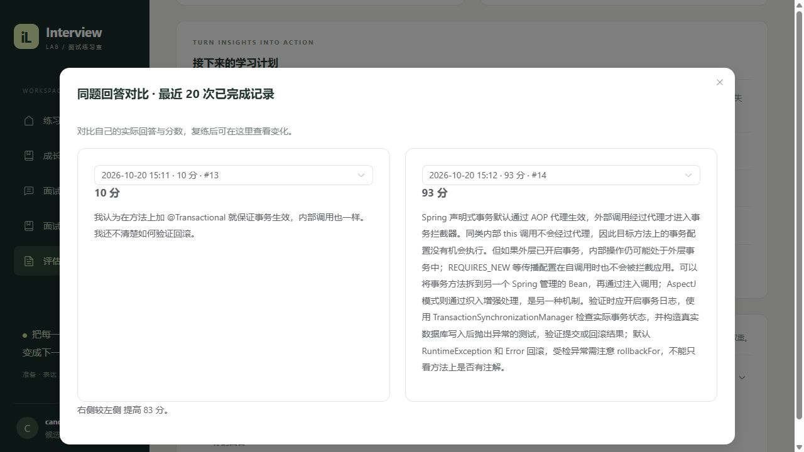
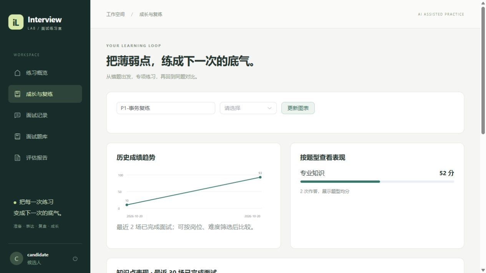
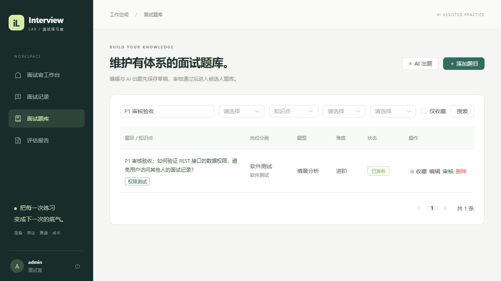
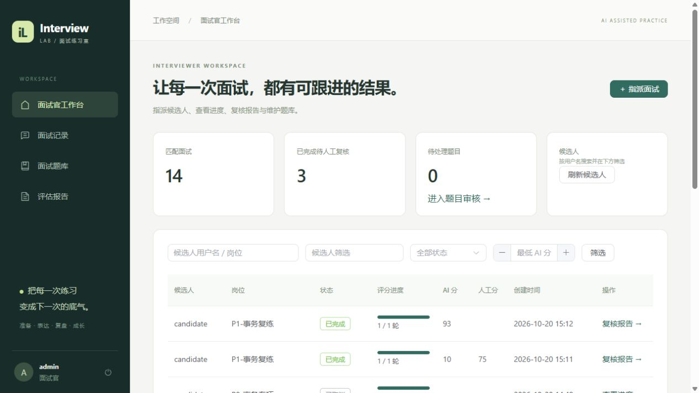

# P1 产品功能与验收

日期：2026-10-20（Asia/Hong_Kong）。延续 Java 17、Spring Boot、Spring AI 的单体结构，不引入微服务、生产压测或新的 Agent 框架。

## 本轮完成

| 范围 | 当前行为 |
| --- | --- |
| 角色业务 | 面试官登录进入独立工作台；按候选人用户名、候选人 ID、岗位、状态和最低 AI 分数筛选；指派面试，查看评分进度，填写人工评语与可选人工评分 |
| 题库体系 | Java 后端、前端开发、软件测试、通用岗位分类；知识点标签；审核、驳回、重新编辑审核；个人收藏；按分类、知识点和难度组卷 |
| 复盘闭环 | 历史低分回答进入错题页；从原题快照重新作答；保留复练关联；并排对比同题前后回答；查看知识点专项与成绩趋势 |
| 页面体验 | 独立报告列表、独立报告详情、任务进度与失败重试、题型表现图表、可筛选成长趋势、服务状态与异常重新加载入口 |

种子题库由 15 道扩充为 **33 道**，按题干幂等补充，不会清空已有题库；另有联调时创建的题目。新增覆盖 Spring、事务、代理、Java 集合与并发、MySQL 索引和事务、Redis、RabbitMQ、接口幂等、Vue、JavaScript、HTTP、测试设计与项目实践。旧面试已保存的回答保持原始快照；未记录知识点的旧回答显示“未分类”。

## 角色边界与审核

面试官可以读取全部候选人的面试与报告，指派时记录 `interviewerId`。候选人只能访问自己的面试、历史回答和复练数据；即使面试官可查看报告，也不能替候选人开始、作答或控制进度。

新建、编辑题目保存为 DRAFT；AI 题库出题为 PENDING。只有 APPROVED 题目向候选人公开并可抽题。审核返回 APPROVED 或 REJECTED，并记录审核人、时间与意见。编辑已发布题目会重新进入草稿状态。原有已发布题目通过 V4 迁移保留发布状态，历史面试快照不受题库编辑或删除影响。

人工评分与 AI 分数分别保存。人工评语只在报告完成后填写，候选人可阅读，候选人不能修改。人工评分不会改变原始 AI 分数、趋势或错题判断。

## 复练与统计口径

- 错题页列出本人已完成面试中低于 **75 分**的历史回答，包括明确计为 0 分的超时、交卷未答记录。它保留历史低分记录，不会在重答提升后删除原回答。
- 同题重答创建新的练习场次，复制原题、参考要点和知识点，不直接覆盖旧答案，也不依赖该题仍在题库中。
- 题库题目按 `questionId` 归集历史；AI 题目或早期无题库 ID 的回答按复练来源归集。不同题库版本在对比中保留各自题干。
- 同题对比读取最近 20 次已完成记录，可分别选择两次实际回答。进行中的回答不会混入历史。
- 成长趋势使用本人最近 30 场已完成面试，可按精确岗位名称和难度筛选。题型与知识点表现由这些场次的单轮评分平均计算，包含追问；并非对外部标准化能力的测量。
- 专项练习按知识点筛选已审核题库。匹配题数不足时返回明确提示，可减少题数或调整分类、难度。未分类的旧回答不提供自动知识点专项按钮。
- 总分仍沿用 P0 主问题组平均规则。人工分不会纳入 AI 总分。

## 新增或扩展接口

全部接口使用原有 JWT。响应格式仍为 `{code,message,data}`。

| 方法 | 路径 | 用途 |
| --- | --- | --- |
| GET | /api/management/candidates | 面试官按用户名搜索候选人，分页 |
| GET | /api/management/workbench | 面试官工作台；keyword、status、candidateId、minScore、page、size |
| POST | /api/interviews | 新增 candidateId、jobFamily、tag；candidateId 仅面试官可指定其他候选人 |
| GET | /api/interviews | 新增 keyword（岗位包含匹配）、difficulty 筛选 |
| GET | /api/interviews/{id}/review | 读取人工评语，遵循面试数据权限 |
| PUT | /api/interviews/{id}/review | 面试官保存人工评语与可选 score（0～100） |
| GET | /api/questions | 新增 jobFamily、tag、reviewStatus、favorites 筛选 |
| GET | /api/questions/tags | 当前角色可见题目中的标签 |
| POST / PUT | /api/questions、/api/questions/{id} | 新增 jobFamily 与 tags 数组，最多 8 个标签 |
| POST | /api/questions/{id}/review | 面试官审核，status 为 APPROVED / REJECTED，note 最长 500 字 |
| PUT / DELETE | /api/questions/{id}/favorite | 收藏 / 取消收藏，重复收藏幂等 |
| GET | /api/learning/mistakes | 本人历史低分回答，支持 tag、keyword、分页 |
| GET | /api/learning/overview | 最近 30 场趋势、题型与知识点统计；支持 position、difficulty |
| GET | /api/learning/turns/{id}/history | 同题最近 20 次已完成回答 |
| POST | /api/learning/turns/{id}/practice | 从本人已完成面试的回答创建同题练习 |

组卷示例：

```json
{
  "position": "Java 后端",
  "jobDescription": "Spring 事务专项",
  "difficulty": "MEDIUM",
  "source": "BANK",
  "count": 1,
  "secondsPerQuestion": 180,
  "mode": "PRACTICE",
  "maxFollowUps": 1,
  "jobFamily": "JAVA_BACKEND",
  "tag": "事务"
}
```

面试官指派时增加候选人 `candidateId`。人工评语示例：`{"score":75,"comment":"需要补充代理边界及回滚验证示例。"}`。score 可为空，评语必填；不会覆盖 AI 分数。

## 验证结果

| 检查 | 结果 |
| --- | --- |
| 后端 Java 17 / Maven package | 38 项测试通过，0 失败、0 错误、0 跳过；26.007 秒 |
| Vue / Vite build | 最后一轮 5.65 秒；仍有 Element Plus 主包体积提示 |
| 增量迁移 | V4 在真实 MySQL 执行成功，旧面试和报告保留 |
| 完整容器部署 | 使用本地 JAR 镜像方式，前后端与三个中间件运行 |
| 真实 DeepSeek 复练 | #13 首答 10 分，#14 重答 93 分；均完成真实 MQ 评分与报告 |
| 人工复核 | #13 人工评分 75，候选人可见，AI 分数仍为 10 |
| 浏览器 | 候选人成长页与岗位筛选、独立报告、同题对比；面试官登录跳转、工作台、指派表单、审核发布 |

新增 8 项自动化测试覆盖审核抽题、标签、收藏幂等与隔离、面试指派和禁止替答、删除题库后的快照复练、历史权限、人工评语权限和分数隔离、成长统计归属、AI 新题待审核；其余 30 项为 P0 回归。自动化业务测试使用 H2 与外部依赖替身。

`scripts/p1-live-check.ps1` 使用真实 MySQL、Redis、RabbitMQ、DeepSeek 和 Nginx 代理，完成 **20 条断言**（含逐条原文引用匹配），原始证据存于被忽略的 `.local/p1-live-results.json`。样本是人工编写的验收回答，不能据此宣称模型评分准确率或学习效果。后续运行使用不同的场次标签，避免与已保留样本冲突。

```powershell
# 会创建题目和两场面试，并实际调用 DeepSeek，产生 API 费用
.\scripts\p1-live-check.ps1
```

界面证据：







## 当前范围

前端继续采用轮询，图表为 Vue / SVG，无额外图表运行依赖。简历针对性面试、语音视频、流式输出和 RAG 仍未实现。题目审核由现有面试官角色承担，未引入组织、招聘录用流程或独立审批角色。

## 收尾回归与改动量

已复现并修正“演示题库补全把已编辑的未分类草稿重新发布”的边界问题：定向测试先失败，修复后完整 38 项测试通过。补全流程只处理已发布且尚未分类的原有演示题，保留草稿、人工内容与审核决定。

与 `.local/p1-before/` 比较，忽略换行差异后，生产源码新增约 2,250 行、删除约 410 行；其中包括抽取原有报告展示组件、18 道新增种子题以及四块 P1 页面与服务。校验约 150 行（人工估算）；自动化测试新增约 182 行。真实联调脚本与文档另计，未增加通用框架或新外部依赖。



最终修复版本已重新构建并启动；重启后检查前端 HTTP 200、MySQL / Redis / RabbitMQ 可用，工作台匹配到两场复练，人工分 75、复练报告 COMPLETED 且 AI 分 93。证据位于 .local/p1-final-smoke.json。
