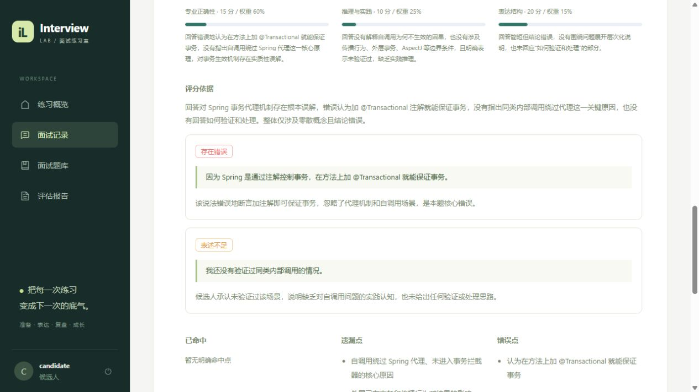

# P0 验证记录

更新日期：2026-10-20（Asia/Hong_Kong）。这是大学生求职项目的定向功能验收，未做生产压测。

## 自动化检查

| 检查 | 结果 | 范围 |
| --- | --- | --- |
| Java 17 / Maven package | 通过 | 30 项测试，0 失败、0 错误、0 跳过；23.771 秒；可执行 JAR |
| Vue / Vite build | 通过 | 最后一轮 5.60 秒；Element Plus 整体引入仍有包体积提示 |
| Compose 配置 | 通过 | 标准编排及本地 JAR 编排，变量与路径解析 |
| Spring AI HTTP 协议 | 通过 | 真实 DeepSeekChatModel 请求本地 HTTP 服务，验证路径、鉴权、模型、thinking 字段和实体转换 |

后端 30 项测试由 InterviewFlowTest 23 项、AiServiceTest 6 项、DeepSeekTransportTest 1 项组成。业务测试使用 H2 MySQL 模式，外部依赖使用 Mockito；协议测试使用本地 HTTP 服务，不消耗真实 API。

覆盖以下实际行为：

- 主问题与追问的上下文、先后顺序、每题一次与全场预算、完整高分回答停止追问。
- 分析后等待确认再开始下一题，分析与等待不消耗作答时间。
- 暂停保存剩余毫秒、恢复期限；模拟模式拒绝暂停，分析中暂停仍保持正确流程。
- 超时与迟交计 0 分，不自动开启后续题；提前交卷后的分组平均分。
- 重复提交、并发提交、重复 MQ 消息不重复推进或插入追问。
- 取消及提前交卷后禁止晚到的 AI 结果追加追问；失败可重试。
- 角色与候选人数据隔离，包括新增控制接口；快照、答案隐藏及 HTTP 输入限制。
- 三种题型的评分维度与加权计算，缺失字段、错误维度、虚构原文引用拒绝入库。

## 真实中间件与 DeepSeek

使用真实 MySQL 8、Redis 7、RabbitMQ 3 与 deepseek-flash，经正式 Controller、Service、MyBatis Mapper、RabbitMQ 消费者和 Spring AI 调用完成。未使用固定评分或页面替身。

`scripts/p0-live-check.ps1 -BaseUrl http://127.0.0.1:9090 -ReusePartialId 6` 完成 19 项检查。复用了此前已完成的真实不完整回答样本，避免重复付费。原始结果与日志保存在被忽略的 `.local/p0-live-results.json` 和 `.local/p0-live-backend.log`。

| 样本 | 主问题分数 | 追问 | 最终分 |
| --- | --- | --- | --- |
| #6：误以为加事务注解即可保证生效，未验证自调用 | 15 | 一次，追问围绕自调用与回滚验证；追问回答 91 分 | 53 |
| #10：说明代理、自调用、外层事务、拆 Bean、AspectJ 与回滚验证 | 91 | 无 | 91 |

总分示例：#6 只有一道主问题组，`round((15 + 91) / 2) = 53`。不同主问题组权重相同。

真实检查还包括：

- 数据库 SELECT、Redis PING、RabbitMQ 连接成功，Spring AI DeepSeek 连通性检查成功。
- 真实回答先保存，再通过 RabbitMQ 分析与生成报告；报告完整且三个评分维度齐全。
- 所检查的评估原文引用均来自对应回答，精确字符串匹配通过。
- 模拟模式 pause 返回 409；练习暂停写库并清除期限，恢复重新建立期限。
- 实际 Redis 到期扫描将当前题标记 TIMEOUT，下一题保持 WAITING 且没有 deadline。
- DeepSeek 实际生成一道 Spring Bean 生命周期题，并保存为独立快照。
- 登出后，Redis 撤销列表使原 JWT 返回 401。

这些是两个回答样本的有界验证，不能证明评分准确率、追问质量或对所有岗位的泛化效果。模型输出有随机性，报告仍需人工判断。

## 浏览器检查

真实中间件环境中使用候选人登录，查看 #6 与 #10 报告、展开评分理由和原文证据；#12 验证开始、输入草稿、暂停、刷新保持暂停、恢复剩余时间与草稿、取消。临时验收面试已取消，已完成报告保留供查看。

下图来自真实 DeepSeek 评估，输入为人工编写的验收回答，不含个人经历：

旧的 `report-preview.png` 是重写初期固定测试数据，不能作为真实模型效果证明。

## 环境问题与部署记录

- Docker Desktop 4.71.0 在重新启动时，两个运行目录中的残留套接字无法访问。已停止失败进程，将仅含套接字的临时目录改名保留，再同时创建空目录后恢复；未重置 Docker、未删除容器数据卷。
- Windows 当前排除端口范围包含 8080。根目录 .env 设置 `BACKEND_PORT=9090`，启动脚本和 Vite 代理读取同一配置；Compose 仅改变宿主端口，容器内部仍为 8080。
- 标准多阶段后端镜像构建在拉取 Maven 基础镜像时两次发生 EOF，未通过；已提供 `Dockerfile.jar` 与 `compose.jar.yml`，使用本地验证过的 JAR 构建后端镜像成功。前端 Nginx 镜像构建成功。
- 完整容器部署通过：前端、后端和三个中间件均运行；前端 HTTP、Nginx 代理、后端存活接口均返回 200。通过前端代理登录面试官，三个依赖检查均为 true，读取 #10 报告状态 COMPLETED、总分 91、三个评分维度；容器内实际 DeepSeek 检查返回 available=true。结果保存于 `.local/p0-compose-results.json`。

不需要升级 Docker、恢复出厂或清空数据库来运行本项目。

当前可直接访问 http://localhost:3000，后端 API 文档为 http://localhost:9090/swagger-ui.html。再次启动已有镜像可用 `docker compose -f compose.yml -f compose.jar.yml up -d --no-build`；源代码修改后按 README 先打包再构建。

## 改动量

与 `.local/p0-before/` 源码快照比较，前后端主源码新增约 1,213 行、删除约 321 行；加上启动和部署配置，新增手写生产代码约 1,250 行，其中约 130 行为输入、模型输出及状态校验（人工估算）。后端测试新增 425 行、删除 110 行；真实联调脚本与文档另计。未加入通用 Agent 框架或生产级测试平台。

## P1 后续更新

2026-10-20 已完成角色工作台、题库分类审核、错题复练与独立报告页。当前后端为 38 项测试通过，真实复练与容器验收结果见 [P1 记录](P1.md)。本文件以上 P0 记录保留为当时验证证据。
